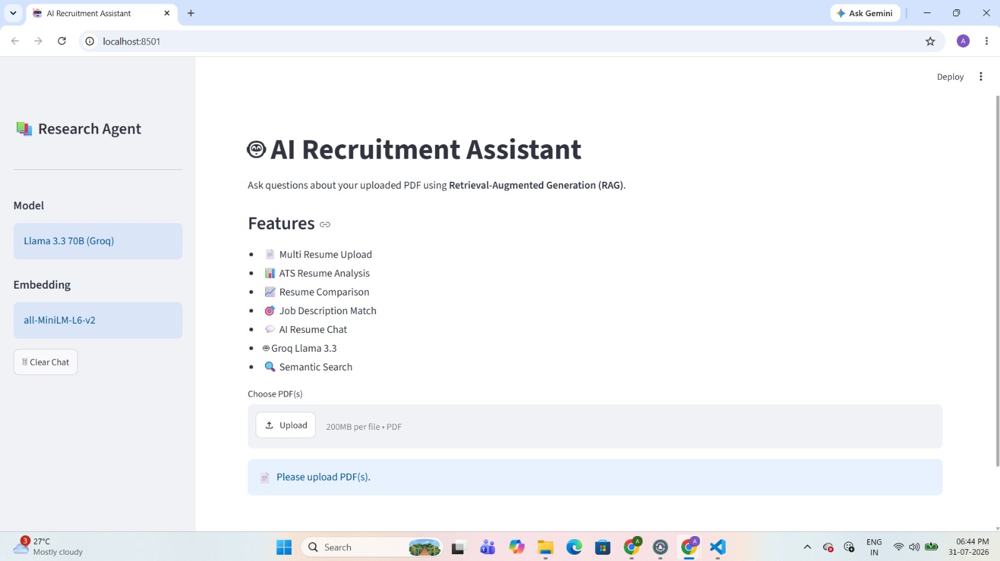
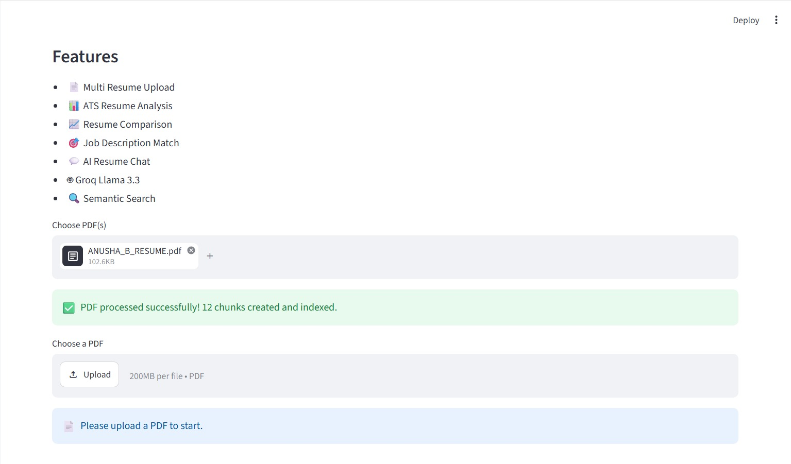
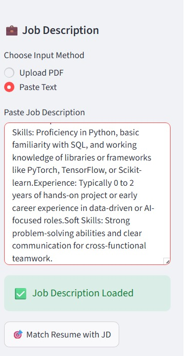
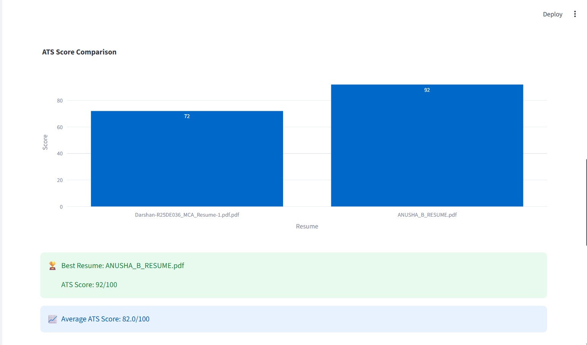
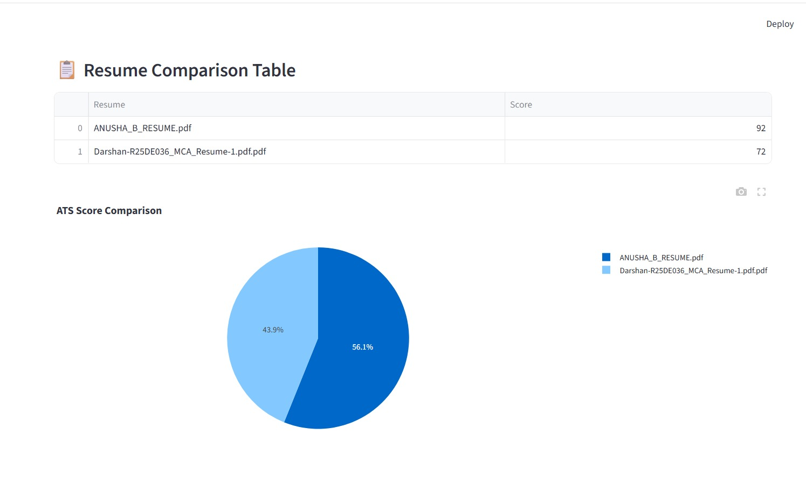
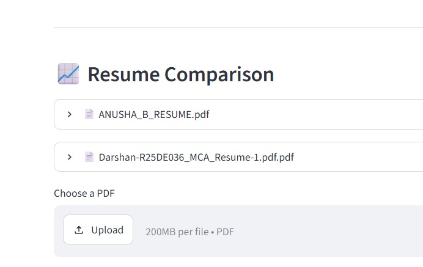
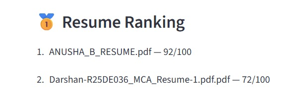
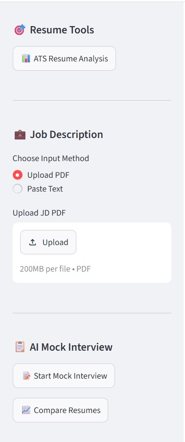
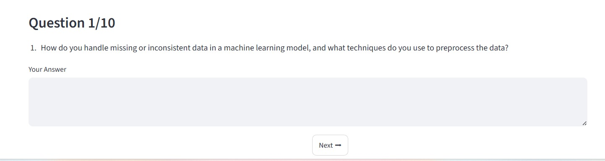
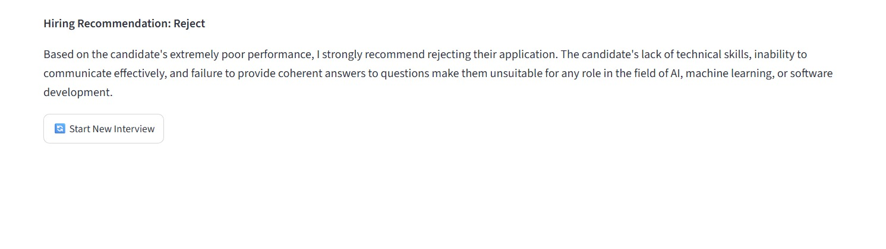

# 🤖 AI Recruitment Assistant

An AI-powered Recruitment Assistant built using **Streamlit**, **Groq Llama 3.3**, **FAISS**, and **Sentence Transformers**.

This application helps recruiters and candidates by providing ATS resume analysis, resume comparison, job description matching, AI-powered mock interviews, and document-based question answering using Retrieval-Augmented Generation (RAG).

---

# 🚀 Features

### 📄 Multi Resume Upload
- Upload one or more PDF resumes
- Automatic PDF parsing and text extraction

### 📊 ATS Resume Analysis
- ATS Score (0–100)
- Resume strengths
- Weaknesses
- Missing keywords
- Improvement suggestions
- Recommended job roles

### 📈 Resume Comparison
- Compare multiple resumes
- Resume ranking
- Best resume selection
- ATS comparison charts
- Download ATS reports

### 🎯 Job Description Matching
- Upload or paste a Job Description
- Resume vs JD matching
- Match percentage
- Missing skills
- Keyword analysis
- Suggestions to improve resume

### 🎤 AI Mock Interview
- Generates interview questions based on:
  - Resume
  - Job Description
- Previous & Next navigation
- Stores candidate answers
- Final interview evaluation
- Overall score and feedback

### 💬 AI Resume Chat
Ask questions such as:
- Summarize my resume
- Generate interview questions
- Explain my skills
- Suggest improvements
- Recommend projects

### 📚 Retrieval-Augmented Generation (RAG)
- Semantic document search
- Context-aware responses
- Source citations
- Fast retrieval using FAISS

---

# 🛠 Tech Stack

- Python
- Streamlit
- Groq API
- Llama 3.3 70B Versatile
- Sentence Transformers
- FAISS
- PyMuPDF
- Plotly
- Pandas
- dotenv

---

# 📂 Project Structure

```
AI-Recruitment-Assistant/
│
├── app.py
├── requirements.txt
├── README.md
├── .env
│
├── database/
│   └── database.py
│
├── utils/
│   ├── ats.py
│   ├── chunking.py
│   ├── embeddings.py
│   ├── extract_score.py
│   ├── interview.py
│   ├── jd_loader.py
│   ├── jd_match.py
│   ├── llm.py
│   ├── pdf_loader.py
│   ├── pdf_processor.py
│   ├── rag_pipeline.py
│   ├── resume_compare.py
│   ├── resume_tools.py
│   ├── tables.py
│   ├── charts.py
│   └── vector_store.py
│
└── uploads/
```

---

# ⚙ Installation

## Clone Repository

```bash
git clone https://github.com/yourusername/AI-Recruitment-Assistant.git

cd AI-Recruitment-Assistant
```

## Create Virtual Environment

```bash
python -m venv venv
```

### Windows

```bash
venv\Scripts\activate
```

### Linux / Mac

```bash
source venv/bin/activate
```

---

## Install Dependencies

```bash
pip install -r requirements.txt
```

---

## Add Environment Variables

Create a `.env` file.

```text
GROQ_API_KEY=your_api_key_here
```

---

## Run Application

```bash
streamlit run app.py
```

---

# 📷 Screenshots

Add screenshots of:

- Home Page
- ATS Analysis
- Resume Comparison
- JD Match
- AI Mock Interview
- Final Interview Evaluation
- AI Chat

---

# 📈 Workflow

```
Upload Resume(s)
        │
        ▼
Extract PDF Text
        │
        ▼
Create Chunks
        │
        ▼
Generate Embeddings
        │
        ▼
Build FAISS Vector Store
        │
        ├────────► AI Chat (RAG)
        │
        ├────────► ATS Analysis
        │
        ├────────► Resume Comparison
        │
        ├────────► Job Description Matching
        │
        └────────► AI Mock Interview
```

---

# ✨ Future Improvements

- Voice-based interview
- Speech-to-text answers
- Resume builder
- Candidate ranking dashboard
- Recruiter login
- Email interview reports
- Interview recording
- PDF report generation

---

## 📸 Project Screenshots

### 🏠 Home Page


### 📂 PDF Processing


### 📄 Job Description


### 📊 ATS Score Comparison


### 📋 Resume Comparison Table


### 📈 Resume Comparison


### 🏆 Resume Ranking


### 🛠 Resume Tools


### 🎤 AI Mock Interview


### 📝 Interview Evaluation


### ✅ Hiring Recommendation


---

# 👩‍💻 Author

**Anusha B**

Python Full Stack Developer | AI & Machine Learning Enthusiast

GitHub: https://github.com/Anusha-1323

---

# ⭐ If you like this project

Give this repository a ⭐ on GitHub!